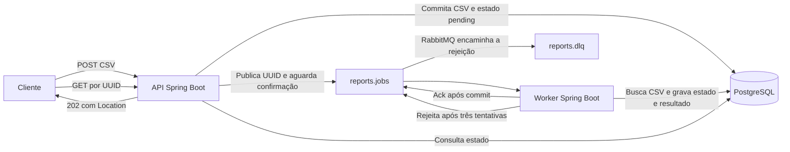

# Relatórios CSV em segundo plano

Projeto de portfólio em Java 21, Spring Boot, RabbitMQ e PostgreSQL. A API aceita um CSV de vendas, devolve um identificador e deixa a agregação para o worker. A demo usa dados fictícios e roda localmente com Docker Compose.

## Rodar a demo

Requisitos no Windows: Docker Desktop iniciado com Docker Compose, PowerShell e `curl.exe`. Execute os comandos na raiz do repositório. O Docker compila o projeto e executa os testes unitários do Java durante o build.

```powershell
docker compose up --build --wait
curl.exe -i -F "file=@examples/sales.csv" http://localhost:8080/reports
```

Copie o endereço do cabeçalho `Location` da resposta `202 Accepted` e consulte o relatório. Também é possível usar o `id` do JSON.

```powershell
$upload = curl.exe -sS -F "file=@examples/sales.csv" http://localhost:8080/reports | ConvertFrom-Json
curl.exe -i "http://localhost:8080/reports/$($upload.id)"
```

Repita o `GET` se o estado ainda for `pending` ou `processing`. Em `completed`, o corpo da resposta terá esta estrutura:

```json
{
  "id": "9d13b159-630b-4dfc-90ec-f01deebcf6ed",
  "status": "completed",
  "result": {
    "saleCount": 3,
    "total": "200.00",
    "totalsByCategory": { "livros": "80.00", "jogos": "120.00" }
  }
}
```

Para ver um erro de validação, envie `examples/invalid-sales.csv`. O upload recebe `202`, e o `GET` retorna `failed` com `error.code` igual a `INVALID_CSV`, `error.line` igual a `3` e uma mensagem sobre o campo `amount`.

```powershell
$upload = curl.exe -sS -F "file=@examples/invalid-sales.csv" http://localhost:8080/reports | ConvertFrom-Json
curl.exe -i "http://localhost:8080/reports/$($upload.id)"
```

O [painel do RabbitMQ](http://localhost:15672) usa `reports` / `reports-local`. Para encerrar a demo e manter o banco e a fila nos volumes, use `docker compose down`.

### Interface web

Abra [Relatórios de vendas](http://localhost:8080) com o mesmo Compose ativo. Selecione ou arraste um arquivo, use **Gerar relatório** e acompanhe o estado. A tela consulta a API a cada segundo enquanto o job estiver pendente ou em processamento. Com um ID existente, use **Consultar por ID**. A tela exibe o resumo com contagem, total e barras por categoria, ou o motivo da falha.

React, TypeScript e Vite compilam a interface durante o build do Docker. O Spring Boot serve a página e a API na mesma porta. As transições usam Motion for React e respeitam a preferência de movimento reduzido. Para desenvolver a interface separadamente, mantenha o Compose ativo e execute `npm ci` e `npm run dev` na pasta `frontend` com Node.js 24.

## Contrato

| Operação | Resposta |
| --- | --- |
| `POST /reports` com campo `file` em `multipart/form-data` | `202` com `id` e `Location` após confirmação do broker. |
| Arquivo maior que 1 MiB | `413` com `FILE_TOO_LARGE`. |
| `POST` sem conseguir confirmar a publicação | `503` com `id`, `Location` e `QUEUE_UNAVAILABLE` se o job ainda estiver pendente. |
| `GET /reports/{id}` | `200` com `id`, `status` e, quando aplicável, `result` ou `error`. UUID desconhecido retorna `404`. |

Envie CSV UTF-8 com cabeçalho `sale_id,category,amount` e pelo menos uma venda. Cada venda ocupa uma linha física e exige `sale_id`, categoria e valor decimal não negativo com ponto e até duas casas. Campos entre aspas podem conter vírgula. O worker conta cada linha válida como uma venda, agrega com `BigDecimal` e retorna os valores como strings com duas casas.

## Como o job passa pela fila



O banco guarda o CSV e o resultado na mesma linha, identificada pelo UUID. O worker registra `processing` em uma operação separada. Uma entrega de um job em `processing` pode retomá-lo, e um job `completed` ou `failed` mantém o estado final em novas entregas. A demo usa um consumidor e prefetch de uma mensagem.

Um CSV inválido encerra o job na primeira tentativa com mensagem e número da linha. Em caso de erro operacional, o worker faz até três tentativas, com pausas de 1 e 2 segundos. Ao esgotá-las, tenta gravar `PROCESSING_FAILED` e rejeita a mensagem sem voltar para a fila principal. O RabbitMQ a encaminha à `reports.dlq`. Se o banco continuar indisponível, a aplicação registra o UUID no log, a mensagem segue para a DLQ e a consulta pode voltar a mostrar o último estado gravado quando o banco retornar.

### Banco gravou, broker indisponível

A API espera até 3 segundos pela confirmação de publicação e exige roteamento. Se houver erro ou a confirmação expirar, a API tenta gravar `failed` com `QUEUE_UNAVAILABLE` apenas se o job ainda estiver `pending`. O cliente recebe `503` com um ID consultável. Se o worker já assumiu o job, a API preserva seu estado e responde `202`.

Se o processo cair após o commit e antes de publicar, um job pode ficar `pending` indefinidamente. O próximo passo para fechar essa janela é um *transactional outbox*. A intenção de publicar passa a ser gravada na mesma transação do job, e um publicador separado tenta enviá-la até obter confirmação. O worker continua aceitando reentregas, inclusive quando a confirmação de publicação se perde.

## Verificar os cenários

Com o Compose ativo, execute:

```powershell
powershell -NoProfile -ExecutionPolicy Bypass -File scripts/verify-demo.ps1
```

O script verifica os totais, CSV inválido, `404`, `413`, reentregas, retomada de `processing`, recuperação após erro temporário, três tentativas em uma falha persistente com envio à DLQ, e indisponibilidade e retorno do broker. Ele instala e remove um gatilho temporário no banco para induzir falhas somente nos UUIDs de teste. Ao executar o cenário de indisponibilidade, o script para e reinicia o RabbitMQ local. Os relatórios e a mensagem de teste da DLQ ficam disponíveis para inspeção.

Com Java 21 ou superior e Maven, rode apenas os testes de parser com `mvn test`.
